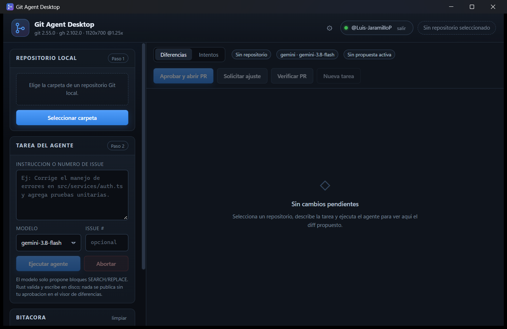
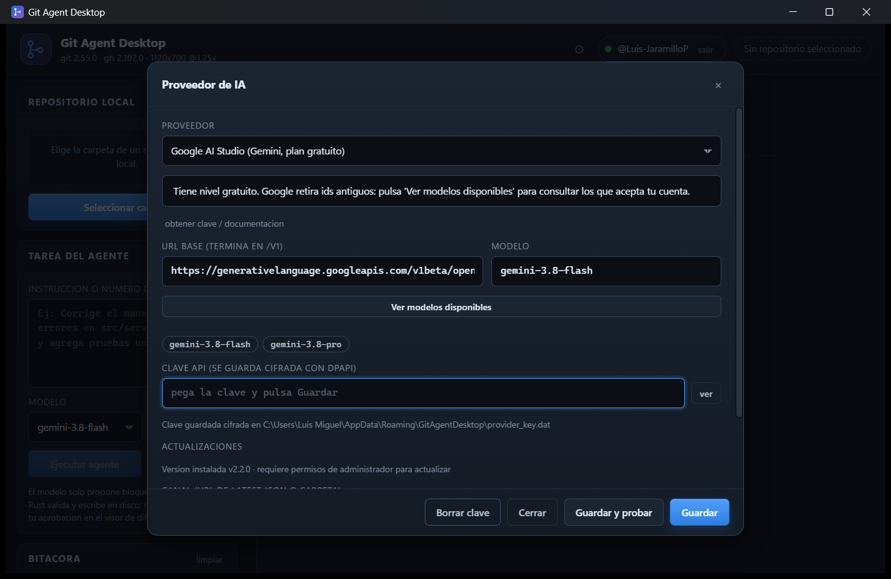
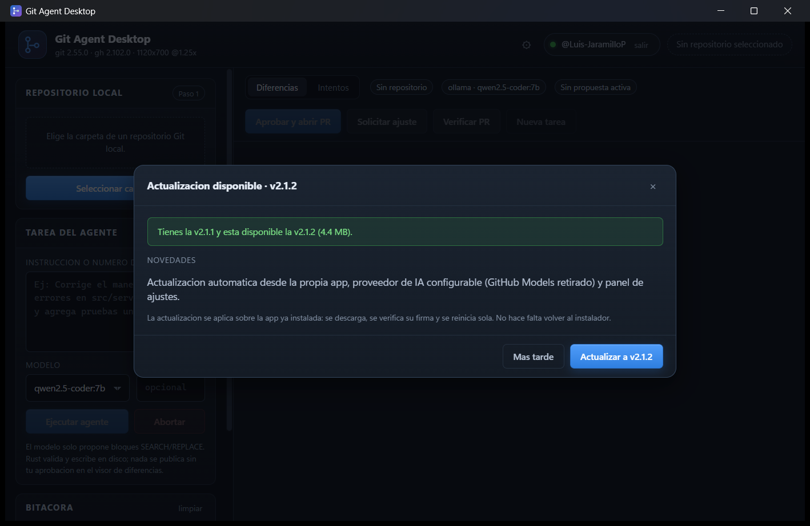

# Git Agent Desktop 2.0

Cliente de escritorio Windows (x64) que automatiza el ciclo de **inspeccion de codigo, edicion
atomica y publicacion de Pull Requests** con aprobacion humana obligatoria.

- **Nucleo determinista**: Rust + Tauri v2 (el modelo nunca ejecuta comandos ni escribe archivos).
- **Razonamiento**: cualquier endpoint compatible con OpenAI (Ollama local, Gemini, Groq, OpenRouter, Foundry, vLLM...). El token de GitHub CLI se usa solo para `git`/`gh`.
- **Interfaz**: HTML + CSS + TypeScript (visor de diffs split/unified estilo IDE).
- **Distribucion**: instalador bootstrapper en Inno Setup con diagnostico e instalacion silenciosa de dependencias.

> Implementacion del documento *«Git Agent Desktop — Plan de Arquitectura y Especificacion Tecnica v2.0»*.

## Descargar e instalar (usuarios finales)

**No uses el boton "Code → Download ZIP"**: eso descarga el codigo fuente, que no se puede ejecutar sin
compilarlo. El instalador esta en *Releases*.

1. Entra en **Releases → Latest**: <https://github.com/Luis-JaramilloP/git-agent-desktop/releases/latest>
2. En **Assets** descarga **`GitAgentSetup.exe`** (el `latest.json` es solo para las actualizaciones).
3. Clic derecho sobre el `.exe` → **Ejecutar como administrador** (asi el instalador puede agregar Git
   y GitHub CLI). Si Windows muestra *"Windows protegio su PC"*: **Mas informacion → Ejecutar de todas
   formas** (el binario no esta firmado).
4. Sigue el asistente. Al final se abre la app y veras la guia `LEEME.txt`.

Descarga directa (este es el enlace que conviene compartir):

```text
https://github.com/Luis-JaramilloP/git-agent-desktop/releases/latest/download/GitAgentSetup.exe
```

Requisitos: Windows 10 1809+ / 11 (x64). El instalador agrega WebView2, Git y `gh` si faltan. Cada
usuario necesita su propio proveedor de IA (Ollama local gratis, o una clave de Gemini/Groq/OpenRouter)
y su sesion de GitHub.


*Captura del binario release en ejecucion (1120x700 @1.25x). La cabecera muestra la linea de
diagnostico viva (versiones de `git`/`gh` y geometria del webview) y el proveedor activo.*



*Panel de Ajustes (⚙): eleccion de proveedor, URL base, modelo, clave cifrada con DPAPI y prueba
real de conexion con un prompt minimo.*

---

## 1. Estado de la implementacion

| Bloque del plan | Estado | Donde |
| --- | --- | --- |
| Arquitectura base Tauri v2 (Rust + TS) | Implementado y compilado | `src-tauri/`, `src/` |
| Autenticacion transparente con `gh` (§3) | Implementado | `src-tauri/src/commands/auth.rs` |
| Instalador bootstrapper Inno Setup (§4–5) | Implementado | `installer/installer.iss` |
| Estructura de directorios (§6) | Implementada (+ modulos extra) | ver §4 |
| Motor de parcheo atomico SEARCH/REPLACE (§7) | Implementado y probado | `commands/patch.rs` |
| Control determinista de Git/gh (§8) | Implementado y probado | `commands/git.rs` |
| Ciclo agentico ReAct + HITL (§9) | Implementado | `agent.rs`, `src/main.ts` |
| Matriz de eventos de PR (§10) | Implementado | `agent::check_pr`, `agent::replan_from_pr` |
| Memoria reflexiva + guardrails (§11) | Implementado | `memory.rs`, `ai/prompts.rs` |
| CRLF/LF, PATH de binarios, cuotas de tokens (§12) | Implementado y probado | `patch.rs`, `utils/process.rs`, `ai/client.rs` |
| Hoja de ruta de compilacion (§13) | Implementado (+ CI) | `scripts/build.ps1`, `.github/workflows/release.yml` |
| Actualizacion automatica | Implementada y probada 2.1.0 → 2.1.1 | `src-tauri/src/updater.rs`, `scripts/publish-update.ps1` |
| Verificacion automatizada | 61 pruebas en verde | `src-tauri/tests/` |

### Release estable 2.2.0 (la "v1.0 distribuible")

La version del proyecto sigue el esquema del documento de arquitectura (arranco en 2.0.0), asi que la
release estable se publica como **2.2.0** y no como 1.0.0: bajar el numero romperia el comparador de
versiones del actualizador (2.1.5 > 1.0.0 y la app no se actualizaria).

**Verificado en vivo** (PRs #1 a #4 del repositorio de prueba real):

| Escenario | Resultado |
| --- | --- |
| Ejecutar → diff → aprobar → PR (Gemini 3.8 Flash) | PR #1 y #2 creados y fusionados |
| Modelo local Ollama `qwen2.5-coder:7b` (sin clave, sin red) | plan y parche correctos (1,3k–3k tokens) |
| Cliente OpenAI-compatible (Groq, OpenRouter, LM Studio, Foundry comparten ruta) | 4 pruebas contra un servidor falso: `/models`, conexion, stub "OK" y 404 |
| CI fallido → re-planificacion | PR #3: `CI_FAILURE`, parche incremental, intento 2/3 |
| Rechazo conceptual | PR #4: `CONCEPTUAL_REJECTION`, re-planificacion bloqueada |
| Merge → limpieza | PR #2: rama local **y remota** eliminadas, `main` actualizado |
| Actualizacion automatica | 2.1.0 → 2.1.1 probada en vivo; el canal publica 2.2.0 |
| Ciclo correctivo repetitivo | detectado y avisado como *"Posible duplicado"* en el visor |

**Firma de codigo**: los binarios aun no llevan firma Authenticode (requiere un certificado). El
workflow firma automaticamente si el repositorio define `WINDOWS_CERT_PFX_BASE64` y
`WINDOWS_CERT_PASSWORD`; sin certificado Windows puede mostrar SmartScreen la primera vez.

**Publicar una version (flujo completo)**

```powershell
# 1) sube la version en los 4 archivos, compila, hace commit, crea el tag y lo empuja
pwsh -File scripts\release.ps1 -Version 2.3.0

# 2) el tag dispara GitHub Actions: pruebas -> build -> instalador -> latest.json -> Release
gh run watch
```

El script es la unica pieza que hay que recordar: **nunca se publica por commit**, solo por version
etiquetada. Asi el canal nunca sirve builds a medias y el numero de version siempre coincide con el
binario.

**Canal remoto de actualizaciones**: el workflow publica `latest.json` junto al instalador en cada
release. La compilacion trae ese canal como valor por defecto; se puede cambiar en Ajustes → Canal (o con `GAD_UPDATE_URL`)
`https://github.com/Luis-JaramilloP/git-agent-desktop/releases/latest/download/latest.json`.

**Limitaciones conocidas de la 2.2.0**:

- `CHANGES_REQUESTED` no se ha ejercitado en vivo porque GitHub no permite revisar tu propio PR; el
  codigo esta cubierto por pruebas y comparte ruta con los demas veredictos.
- Los modelos locales pequenos (7B) pueden repetir contenido en el ciclo correctivo: ahora se avisa
  como *"Posible duplicado"* y el guardrail corta a los 3 intentos.
- El agente no lee PDFs ni otros binarios (por diseno); hay que darle el contenido o convertirlo a texto.
Artefactos generados y comprobados en este equipo: `git-agent-desktop.exe` (9,0 MB),
`GitAgentSetup.exe` (4,4 MB) y la interfaz renderizada sin recortes a 1120x700 @1.25x.
Ver §12 y §13.

Verificaciones ejecutadas en este equipo: `npm run build` (TypeScript estricto + Vite),
`cargo check` sin avisos, `cargo test` (motor de parcheo, arbol filtrado, Git real) y
generacion de iconos. Ver §11.

---

## 2. Requisitos

| Herramienta | Version minima | Uso |
| --- | --- | --- |
| Windows | 10 1809+ / 11 (x64) | Plataforma objetivo |
| Node.js | 20 LTS | Compilar la interfaz |
| Rust (MSVC) | 1.77+ (`stable-x86_64-pc-windows-msvc`) | Compilar el binario |
| Visual Studio Build Tools | C++ x64 + Windows SDK | Enlazador de Rust |
| Git for Windows | 2.30+ | Operaciones del repositorio |
| GitHub CLI (`gh`) | 2.40+ | Autenticacion, PRs, logs de CI |
| Microsoft Edge WebView2 Runtime | Evergreen | Motor de la interfaz (Tauri) |
| Inno Setup | 6.2+ | Solo para empaquetar el instalador |

El instalador `GitAgentSetup.exe` comprueba e instala automaticamente Git, `gh` y WebView2
con `winget`, por lo que el usuario final no necesita preparar nada.

---

## 3. Compilacion en tres comandos (hoja de ruta, §13)

```powershell
# 1) Interfaz web (TypeScript + CSS)
npm install && npm run build

# 2) Binario nativo optimizado (genera src-tauri/target/release/git-agent-desktop.exe)
cargo build --release --manifest-path src-tauri/Cargo.toml

# 3) Instalador bootstrapper (genera dist-installer/GitAgentSetup.exe)
iscc installer/installer.iss
```

O todo de una vez, con deteccion de herramientas y verificacion de artefactos:

```powershell
pwsh -File scripts/build.ps1
```

Opciones: `-SkipFrontend`, `-SkipRust`, `-SkipInstaller`.

### Desarrollo con recarga en caliente

```powershell
npm install
npm run tauri dev
```

### Nota sobre `cargo tauri build` y `custom-protocol`

El plan original usa `cargo tauri build`, que requiere el CLI `cargo-tauri`. Este proyecto
compila con `cargo build --release --features custom-protocol` (equivalente para obtener el
`.exe`) y empaqueta con Inno Setup, que es el instalador definido en el plan. Si prefieres el
CLI oficial:

```powershell
npm run tauri:build     # tauri build --no-bundle
```

> **Importante:** la feature `custom-protocol` no es opcional. Sin ella Tauri compila en modo
> desarrollo y la ventana intenta cargar `devUrl` (`http://localhost:1420`), mostrando
> *«localhost rechazo la conexion»*. El CLI de Tauri la activa sola; con `cargo` hay que pasarla.
> Esta declarada en `src-tauri/Cargo.toml` y la usan `scripts/build.ps1` y el workflow de CI.

---

## 4. Estructura del proyecto

```text
git-agent-desktop/
├── .github/workflows/release.yml     # CI/CD: compila y publica el instalador
├── installer/
│   ├── installer.iss                 # Bootstrapper Inno Setup (§5)
│   └── assets/app_icon.ico           # Icono del instalador
├── scripts/
│   ├── build.ps1                     # Hoja de ruta de compilacion en un comando
│   └── make_icons.py                 # Genera iconos PNG/ICO de la app
├── src/                              # Interfaz (Vite root)
│   ├── index.html                    # Layout principal
│   ├── styles/main.css               # Tema oscuro estilo IDE
│   ├── styles/diff.css               # Resaltado rojo/verde del visor
│   ├── components/
│   │   ├── AuthBadge.ts              # Estado de la sesion de GitHub
│   │   ├── RepoSelector.ts           # Selector de repositorio local
│   │   ├── PromptBox.ts              # Tarea / Issue / modelo
│   │   ├── DiffViewer.ts             # Visor HITL (aprobacion humana)
│   │   └── FeedbackModal.ts          # Estado del PR y auto-correccion
│   ├── api.ts                        # IPC tipado con Rust (invoke)
│   ├── types.ts                      # Contratos compartidos
│   ├── dom.ts                        # Utilidades DOM
│   └── main.ts                       # Orquestacion de la UI
├── src-tauri/
│   ├── Cargo.toml
│   ├── build.rs
│   ├── tauri.conf.json               # Ventana, CSP, identificadores
│   ├── capabilities/default.json     # Permisos IPC (core + dialog)
│   ├── icons/                        # Iconos generados
│   ├── tests/
│   │   ├── patch_engine.rs           # Motor de parcheo, arbol, parser de planes
│   │   ├── git_integration.rs        # Git real: ramas, diff, commit, restauracion
│   │   └── agent_flow.rs             # Ciclo agentico end-to-end (sin ventana)
│   └── src/
│       ├── main.rs                   # Punto de entrada (+ DPI awareness)
│       ├── lib.rs                    # Registro de comandos IPC y geometria de ventana
│       ├── ui.rs                     # Puente de eventos Tauri <-> Reporter
│       ├── agent.rs                  # Ciclo agentico (ReAct + HITL + correccion)
│       ├── state.rs                  # Estado compartido + eventos
│       ├── config.rs                 # Configuracion persistente (sin secretos)
│       ├── memory.rs                 # Bitacora reflexiva por repositorio
│       ├── tree.rs                   # Arbol filtrado + lectura segura
│       ├── commands/
│       │   ├── auth.rs               # gh auth status/login/token
│       │   ├── git.rs                # git checkout/diff/commit/push
│       │   ├── patch.rs              # SEARCH/REPLACE atomico + CRLF
│       │   ├── pr.rs                 # gh pr view/comment/close/run log
│       │   ├── agent.rs              # Comandos IPC del ciclo
│       │   └── config.rs             # Configuracion, modelos, abrir enlaces
│       ├── ai/
│       │   ├── client.rs             # HTTP compatible OpenAI + Two-Stage Context
│       │   ├── providers.rs          # Catalogo de proveedores y presets
│       │   └── prompts.rs            # Planificador / Editor / Corrector
│       └── utils/
│           └── process.rs            # Subprocesos + resolucion de binarios
├── package.json
├── tsconfig.json
└── vite.config.ts
```

Sobre el plan original se anadieron: `agent.rs` (orquestacion), `state.rs`, `config.rs`,
`memory.rs`, `tree.rs`, `commands/agent.rs`, `commands/config.rs`, `api.ts`, `types.ts`,
`dom.ts` y `tests/`. Los modulos exigidos por el plan (`commands/{auth,git,patch,pr}.rs`,
`ai/{client,prompts}.rs`, `utils/process.rs`) existen con las mismas responsabilidades.

---

## 5. Uso (flujo completo)

1. **Conectar GitHub** — la cabecera ejecuta `gh auth status`. Si no hay sesion, el boton
   *conectar* lanza `gh auth login --web` y abre el navegador (codigo de un solo uso en la bitacora).
2. **Seleccionar repositorio** — elige la carpeta del repositorio Git local.
3. **Describir la tarea** — texto libre y, opcionalmente, el numero de Issue. Elige el modelo.
4. **Ejecutar agente**:
   - *Etapa 1*: Rust envia al modelo solo el **arbol de rutas filtrado** y este devuelve los 2–4 archivos necesarios.
   - *Etapa 2*: Rust envia el contenido literal de esos archivos y el modelo devuelve bloques `SEARCH/REPLACE` en JSON.
   - Rust valida el plan, crea la rama `agent/<slug>`, normaliza CRLF/LF y escribe los cambios de forma atomica.
   - La interfaz muestra el `git diff` real en verde/rojo.
5. **Aprobar y abrir PR** — commit semantico + `git push` + `gh pr create`. Nada se publica sin este paso.
   Alternativas: **Solicitar ajuste** (ciclo correctivo con tu feedback) o **Abortar** (restaura el
   contenido previo exacto de los archivos).
6. **Verificar PR** — lee `gh pr view --json state,comments,reviews,files,statusCheckRollup` y aplica la
   matriz de la §10:

   | Veredicto | Accion |
   | --- | --- |
   | `MERGED` | Vuelve a la base, `git pull --ff-only`, borra la rama local, cierra la tarea en la bitacora. |
   | `CHANGES_REQUESTED` | Re-planifica un parche incremental sobre la misma rama. |
   | `CI_FAILURE` | Extrae `gh run view --log-failed` y re-planifica con el traceback como contexto. |
   | `TECHNICAL_REJECTION` | Plan nuevo en rama limpia (`agent/<slug>-v2`). |
   | `CONCEPTUAL_REJECTION` | Cancela la tarea: no se abren mas PRs. |
   | `PENDING` | Sin acciones automaticas. |

Guardrails (§11): maximo **3** ciclos correctivos (`maxAttempts`), aprobacion humana obligatoria en cada
reintento y clasificador de rechazo conceptual por palabras clave del cierre del PR.

---

## 6. Seguridad

- **Zero plaintext secrets**: la app nunca escribe tokens en `.env`, JSON ni SQLite. Obtiene el token
  con `gh auth token` **en memoria** (`commands/auth.rs::get_token`) y solo lo usa en la cabecera
  `Authorization: Bearer` de `git push`/`gh pr create`. Ese token **no se expone a la interfaz** (no existe
  comando IPC que lo devuelva).
- **Rutas confinadas**: `patch::sanitize_rel_path` rechaza rutas absolutas, `..`, unidades `C:` y
  contenido de `.git/`; ademas canonicaliza y comprueba que el archivo no escape del repositorio.
- **Escritura atomica**: todos los bloques se validan en memoria antes de escribir el primero y, si
  falla una escritura, se revierte lo ya escrito.
- **Contexto minimo**: nunca se envian al modelo `.env`, claves privadas (`.pem`, `.key`, `.pfx`),
  lockfiles, `node_modules`, `target`, `dist`, `build` ni binarios (`tree.rs`).
- **CSP estricta** en `tauri.conf.json` y capacidades IPC limitadas a `core:default` + `dialog`.
- **XSS**: el visor construye el DOM con `textContent`, nunca con `innerHTML` de contenido del repo.

---

## 7. Configuracion

Archivo `%APPDATA%\GitAgentDesktop\config.json` (gestionado por `config_get` / `config_set`):

| Campo | Por defecto | Descripcion |
| --- | --- | --- |
| `provider` | `ollama` | Proveedor de inferencia (`ollama`, `lmstudio`, `gemini`, `groq`, `openrouter`, `custom`) |
| `model` | `qwen2.5-coder:7b` | Id del modelo en el proveedor activo |
| `baseUrl` | *(vacio = la del preset)* | Endpoint; debe aceptar `POST {base}/chat/completions` |
| `temperature` | `0.1` | Creatividad (se omite en modelos que no la soportan) |
| `maxTokens` | `8192` | Tokens de salida por peticion |
| `maxFileBytes` | `300000` | Tamano maximo por archivo enviado |
| `maxContextChars` | `120000` | Presupuesto total de contexto de la etapa 2 |
| `maxFilesInTree` | `400` | Rutas maximas en la etapa 1 |
| `maxAttempts` | `3` | Guardrail de ciclos correctivos |
| `mockAi` | `false` | Modo de pruebas sin red |

Variables de entorno utiles (diagnostico y pruebas):

| Variable | Efecto |
| --- | --- |
| `GAD_PROVIDER` / `GAD_MODEL` / `GAD_BASE_URL` | Sobrescriben proveedor / modelo / endpoint |
| `GAD_API_KEY` | Clave del proveedor sin pasar por Ajustes (tiene prioridad sobre la guardada) |
| `GAD_MOCK_AI=1` | Planificador y editor deterministas offline (sin red ni clave) |
| `GAD_GIT_BIN` / `GAD_GH_BIN` | Ruta absoluta a `git` / `gh` (util con binarios portables) |

La bitacora de intentos se guarda por repositorio en `%APPDATA%\GitAgentDesktop\memory\<hash>.json`
(sin credenciales; solo tarea, diff, evidencia del revisor y resultado).

### Proveedor de IA: GitHub Models fue retirado

**GitHub Models dejo de existir el 30 de julio de 2026** (playground, catalogo, API de inferencia y
BYOK). `models.github.ai` sigue resolviendo a IPs de GitHub, pero responde un stub `200 OK` en texto
plano a cualquier peticion, incluso sin token; `models.inference.ai.azure.com` ya no existe en DNS.
Ese stub es exactamente el error `Respuesta no JSON de GitHub Models … "OK"`.

Por eso la app habla el protocolo de chat de OpenAI contra un endpoint configurable, con presets:

| Preset | URL base | Clave | Nota |
| --- | --- | --- | --- |
| `ollama` | `http://127.0.0.1:11434/v1` | no | Gratis y privado (por defecto) |
| `lmstudio` | `http://127.0.0.1:1234/v1` | no | Servidor local con interfaz |
| `gemini` | `https://generativelanguage.googleapis.com/v1beta/openai` | si | Nivel gratuito de AI Studio |
| `groq` | `https://api.groq.com/openai/v1` | si | Cuota gratuita, muy rapido |
| `openrouter` | `https://openrouter.ai/api/v1` | si | Modelos `:free` disponibles |
| `custom` | la que escribas | si | vLLM, LocalAI, Foundry, DeepSeek... |
| `github-models` | `https://models.github.ai/inference` | no | **Retirado**: solo se conserva como referencia |

La clave se guarda **cifrada con DPAPI** en `%APPDATA%\GitAgentDesktop\provider_key.dat` (solo la
cuenta de Windows que la guardo puede descifrarla) o se lee de `GAD_API_KEY`; nunca se escribe en
texto plano ni se devuelve a la interfaz. El panel de Ajustes (⚙) permite elegir preset, editar URL y
modelo, guardar la clave y **probar la conexion** con un prompt real antes de usar el agente.

---

## 8. Pruebas

```powershell
# Motor de parcheo + arbol + parser de planes + slug de ramas
cargo test --manifest-path src-tauri/Cargo.toml --test patch_engine

# Integracion con Git real (se omiten si git no esta instalado)
cargo test --manifest-path src-tauri/Cargo.toml --test git_integration

# Ciclo agentico completo sin interfaz (modo determinista, sin red)
cargo test --manifest-path src-tauri/Cargo.toml --test agent_flow

# Catalogo de proveedores, configuracion y clave cifrada (DPAPI)
cargo test --manifest-path src-tauri/Cargo.toml --test providers

# Todo (43 pruebas)
cargo test --manifest-path src-tauri/Cargo.toml
```

**`patch_engine` (21 pruebas)** — sustitucion exacta, **preservacion de CRLF** (el diff no se
ensucia), archivos LF que no ganan CRLF, `SEARCH` inexistente sin tocar el disco, atomicidad entre
archivos, creacion con `SEARCH` vacio, rechazo de rutas maliciosas (`..`, `C:\`, `/etc`), `restore`
exacto, `preview` sin escritura, conteo de lineas del diff, aviso de bloques ambiguos, varios bloques
por archivo, filtrado de ruido/secretos del arbol, deteccion de binarios, extraccion de JSON con
fences y comas finales, alias `camelCase`/`snake_case` del plan y slugs seguros.

**`git_integration` (7 pruebas)** — inspeccion de repositorio real, rama aislada y borrado seguro,
deteccion de cambios + `git diff` real, commit del agente sin diff pendiente, restauracion tras
parchear, resolucion del *toplevel* desde subcarpetas y ejecucion de subprocesos.

**`agent_flow` (7 pruebas)** — ciclo end-to-end con `GAD_MOCK_AI=1` y Git real: `agent::run` crea la
rama `agent/*`, aplica el parche, produce el diff y deja la sesion en fase `review` **sin commitear
ni publicar**; una segunda ejecucion se rechaza por propuesta pendiente; `agent::abort` restaura el
contenido original y elimina la rama; se verifican el guardrail de 3 ciclos, el ajuste incremental,
los mensajes de error de entrada y el fallo controlado de `publish` sin remoto. Ademas comprueba que
la bitacora reflexiva registra el intento abortado.

**`providers` (8 pruebas)** — catalogo con alternativas locales, marcado del proveedor retirado, URL y
modelo efectivos, saneado de proveedores desconocidos, error accionable al elegir un proveedor retirado,
arranque bloqueado sin clave cuando el proveedor la exige, modo prueba sin proveedor y **cifrado DPAPI**
de la clave (se comprueba que el archivo no contiene el texto plano y que se recupera intacto).

> El ciclo se prueba sin ventana porque `agent.rs` y `state.rs` dependen solo de la abstraccion
> `Reporter` (`crate::ui` conecta esa abstraccion con los eventos de Tauri).

---

## 9. Geometria de ventana y DPI (Windows)

Dos detalles que afectan a la experiencia en equipos reales y que estan resueltos:

1. **Conciencia de DPI.** El binario no lleva manifiesto de aplicacion, asi que Windows arrancaba el
   proceso como *DPI-unaware*: la ventana se creaba con tamano fisico mientras WebView2 renderizaba
   al 125 %, dejando el contenido mas grande que su ventana (recortado por la derecha). `main.rs`
   declara `SetProcessDpiAwarenessContext(PER_MONITOR_AWARE_V2)` antes de crear ninguna ventana.
2. **Ajuste al monitor.** `lib.rs` limita tamano y posicion al area util del monitor cuando la
   ventana ya esta mapeada (`clamp_window_to_monitor`), porque el centrado automatico usa metricas ya
   escaladas y puede dejar la ventana fuera de pantalla en portatiles con 125 % / 150 %.

La cabecera muestra una linea de diagnostico viva: `git <v> · gh <v> · <ancho>x<alto> @<dpr>x`
(p.ej. `1120x700 @1.25x`). Es la forma mas rapida de detectar problemas de escalado o de binarios
no detectados en un equipo de usuario.

---

## 10. Instalador bootstrapper

`installer/installer.iss` genera `dist-installer/GitAgentSetup.exe` con:

1. **Diagnostico previo** de `git`, `gh` y WebView2 Runtime (PATH + rutas absolutas de respaldo).
2. **Instalacion silenciosa** de lo que falte con `winget` (`Git.Git`, `GitHub.cli`,
   `Microsoft.EdgeWebView2Runtime`), mostrando el avance en la etiqueta de estado del asistente.
3. **Degradacion controlada**: si `winget` no existe o falla, avisa y permite continuar (la app
   incluye su propio diagnostico en el arranque).
4. **Instalacion por usuario o para todos** (`PrivilegesRequiredOverridesAllowed=dialog`), accesos
   directos en Escritorio y Menu Inicio, icono y registro de desinstalacion.
5. Al desinstalar **conserva las credenciales de `gh`** en el Administrador de Credenciales de Windows
   (son del usuario, no del producto).

### Actualizaciones automaticas (sin volver al instalador)

La app instalada se actualiza sola: al arrancar consulta un canal, y si hay una version nueva abre una
ventana pequeña que descarga, verifica y aplica los cambios, reiniciandose al final. No hay que volver
a ejecutar el instalador a mano.



**Como funciona**

1. `update_check` lee el manifiesto `latest.json` del canal y compara versiones.
2. Si hay novedad, la UI muestra la ventana con version, tamaño y notas.
3. Al aceptar, `update_apply` descarga el instalador, comprueba el **SHA-256** del manifiesto y lo
   lanza con `/SILENT /CLOSEAPPLICATIONS /NORESTART`: se ve la barra de progreso de Inno Setup
   mientras reemplaza los archivos.
4. La app se cierra para liberar el `.exe` y el propio instalador la vuelve a abrir al terminar.
5. Si la instalacion esta en una carpeta protegida (**Program Files**), el instalador se lanza con
   `runas` y Windows pide elevacion una vez por actualizacion. En una instalacion por usuario
   (`%LOCALAPPDATA%\Programs`) la actualizacion es completamente silenciosa.

**Publicar una version**

```powershell
# 1) subir la version en src-tauri\Cargo.toml, tauri.conf.json, package.json e installer\installer.iss
# 2) compilar y publicar en el canal local
pwsh -File scripts\publish-update.ps1 -Notes "Corrige el manejo de errores del agente"
```

El script compila, calcula el SHA-256 y escribe el canal por defecto:

```text
%APPDATA%\GitAgentDesktop\updates\latest.json
%APPDATA%\GitAgentDesktop\updates\GitAgentSetup.exe
```

**Formato del manifiesto**

```json
{
  "version": "2.1.1",
  "notes": "Novedades que se muestran en la ventana",
  "url": "GitAgentSetup.exe",
  "sha256": "02224abb…",
  "size": 4622766,
  "mandatory": false
}
```

`url` puede ser relativa al manifiesto o absoluta, de modo que el mismo formato sirve para un canal
local, un servidor propio o GitHub Releases. Para usar un canal remoto, define `updateUrl` en
Ajustes (o `%APPDATA%\GitAgentDesktop\config.json`) con la URL del `latest.json`.

La comprobacion tambien puede lanzarse a mano desde **Ajustes (⚙) → Buscar actualizaciones**, donde
se muestra la version instalada, el canal y si se necesitan permisos de administrador.

---

## 11. CI/CD

`.github/workflows/release.yml` compila en `windows-latest` ante un tag `v*` o manualmente:
Node 20 → Rust stable (MSVC) con cache → `npm ci` → `npm run build` →
`cargo build --release --features custom-protocol` → Inno Setup via Chocolatey → `iscc` →
verificacion del artefacto → upload + GitHub Release.

---

## 12. Bitacora de ejecucion (paso por paso)

1. **Lectura del plan**. El adjunto es en realidad un `.docx` (no PDF): se extrajo el texto completo
   (345 lineas) y se identificaron las 13 secciones y los artefactos exigidos.
2. **Auditoria del entorno**. Node 24 / npm 11; WebView2 155.x; MSVC 14.51 + Windows SDK 10.0.26100;
   escalado de pantalla al 125 %. Faltaban Rust, Git, `gh` e Inno Setup. Se instalo Rust 1.99.1
   (`stable-x86_64-pc-windows-msvc`) con `rustup-init`, y se usaron binarios portables de MinGit 2.56
   y `gh` 2.102 para las pruebas (sin privilegios de administrador).
3. **Andamiaje**. Estructura de directorios de la §6 + carpetas propias (`scripts/`, `tests/`).
4. **Frontend**. `index.html`, `main.css` (tema IDE), `diff.css`, 5 componentes TS, `api.ts`,
   `types.ts`, `dom.ts`, `main.ts`. `npm run build` → `tsc --noEmit` estricto + Vite OK.
5. **Backend Rust**. `Cargo.toml` (tauri 2, reqwest+rustls, tokio, similar, chrono, dirs),
   `tauri.conf.json` (ventana, CSP, bundle NSIS), `capabilities`, iconos generados con Pillow.
   Modulos: `main`, `lib`, `ui`, `state`, `config`, `memory`, `tree`, `agent`, `commands/*`, `ai/*`,
   `utils/*`. `cargo check`: 2 errores corregidos (`similar::UnifiedDiff::header` y un import).
6. **Pruebas**. `patch_engine` (21) + `git_integration` (7) + `agent_flow` (7) = **35 pruebas OK**
   con `GAD_GIT_BIN` apuntando a MinGit.
7. **Validacion real de la interfaz**. Se compilo el binario release, se lanzo y se capturo la ventana.
   Aqui aparecieron y se corrigieron tres defectos que solo se ven ejecutando:
   - la ventana cargaba `devUrl` porque faltaba la feature `custom-protocol` (pantalla de error
     *localhost rechazo la conexion*);
   - el proceso era DPI-unaware y el webview quedaba un 25 % mas grande que su ventana (recorte a la
     derecha); se declaro `PER_MONITOR_AWARE_V2` en `main.rs`;
   - el centrado de Tauri usaba metricas escaladas y dejaba la ventana fuera de pantalla; se sustituyo
     por `clamp_window_to_monitor` con tamano y posicion deterministas.
8. **Empaquetado**. Inno Setup 6.7.3 instalado en modo usuario (`/CURRENTUSER`), `iscc` compila
   `installer/installer.iss` sin errores → `dist-installer/GitAgentSetup.exe`. Ademas:
   `scripts/build.ps1`, workflow de GitHub Actions y este README.
9. **Artefactos**. `src-tauri/target/release/git-agent-desktop.exe` (9,0 MB) e
   `dist-installer/GitAgentSetup.exe` (4,4 MB). Ver §13 para el alcance exacto de lo verificado.

---

## 13. Alcance de la verificacion y limitaciones

Verificado en esta maquina:

- compilacion limpia del frontend (`tsc` estricto + Vite) y del backend (`cargo check`, `cargo build
  --release` con CERO avisos);
- 35 pruebas automatizadas en verde, incluidas las que ejercitan Git real y el ciclo agentico completo
  (rama, parcheo, diff, sesion HITL, abort con restauracion, guardrails);
- arranque real del binario con la interfaz renderizada y sin recortes (ventana 1120x700 @1.25x);
- generacion del instalador bootstrapper con Inno Setup.

No ejercitado en vivo (requiere una cuenta de GitHub con acceso a Models, ausente en este equipo):

- llamadas reales de inferencia: el codigo del cliente OpenAI-compatible esta probado en sus capas
  deterministas (parseo, errores, auth, catalogo) y el panel Ajustes incluye un boton **Probar conexion**,
  pero en este equipo no habia proveedor activo (ni Ollama instalado ni clave de Gemini/Groq/OpenRouter);
- `gh auth login --web`, `git push` y `gh pr create` contra un remoto real;
- la matriz de eventos del PR (§10) con PRs reales: `check_pr`/`replan_from_pr` estan implementadas y
  se compilan, pero su verificacion end-to-end necesita un repositorio remoto y revisiones humanas.

Todo ese camino comparte el mismo motor ya probado (parcheo, rama, diff, sesion), y el cliente HTTP
maneja explicitamente 401/403/404/413/429 con mensajes accionables para que el primer uso real sea
diagnosticable desde la propia bitacora.

---

## 14. Solucion de problemas

| Sintoma | Causa / solucion |
| --- | --- |
| «No hay una sesion activa de GitHub» | `gh auth login --web`. El token debe permitir Models. |
| HTTP 401/403 al llamar al modelo | Token caducado o sin acceso a Models: `gh auth status`, vuelve a autenticarte. |
| HTTP 404 «modelo no disponible» | El id no existe en el proveedor: corrigelo en Ajustes (⚙). |
| «Respuesta no JSON … "OK"» | El endpoint no expone la API de chat (era el caso de GitHub Models, retirado el 30-jul-2026). Elige otro proveedor en Ajustes. |
| HTTP 413 / 429 | Reduce `maxContextChars` o usa un modelo con mas cuota; el cliente reintenta 429 con espera. |
| Ventana con *«localhost rechazo la conexion»* | Compilaste sin `--features custom-protocol`. |
| La interfaz se ve recortada o desproporcionada | Problema de DPI: revisa la linea de diagnostico de la cabecera (`ancho x alto @dpr`). |
| «No se encontro el ejecutable 'git'» | Instala Git for Windows o define `GAD_GIT_BIN` con la ruta absoluta. |
| «El bloque SEARCH no coincide exactamente» | El modelo invento texto: usa *Solicitar ajuste*; el motor exige coincidencia literal. |
| Las ramas `agent/*` se acumulan | Tras el merge se borran automaticamente; si no, `git branch -D agent/...`. |
| `iscc` no se reconoce | Instala Inno Setup 6 (`winget install -e --id JRSoftware.InnoSetup`) y reinicia la terminal. |

---

## 15. Licencia y autoría

Proyecto derivado del documento de arquitectura v2.0. Uso interno/demostrativo.
